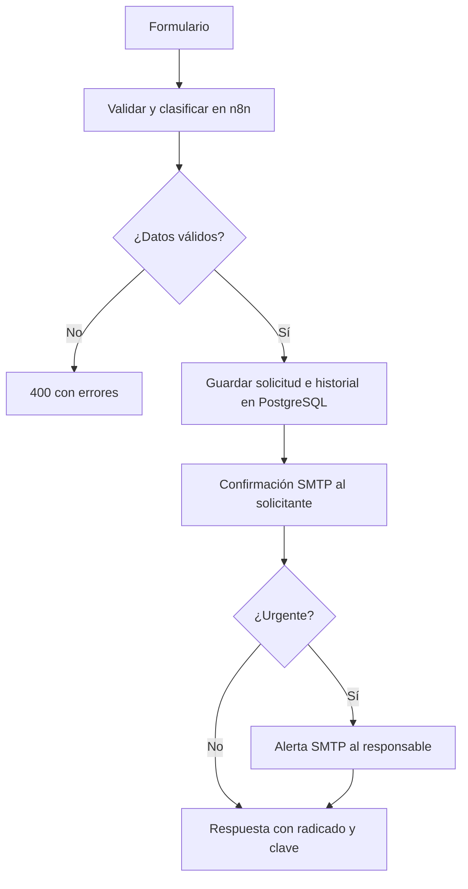

# Automatización de PQRS y soporte

Actividad de Desarrollo de Aplicaciones Empresariales, sexto semestre de Tecnología en Desarrollo de Sistemas Informáticos. Docente: Wilson Castaño Galviz.

El proceso elegido recibe solicitudes, valida y clasifica sus datos, calcula un plazo de atención, guarda un radicado en PostgreSQL y envía una confirmación por SMTP. Si la solicitud es urgente, también envía una alerta al responsable. El portal permite consultar un caso mediante radicado y clave privada; el panel de atención permite gestionar casos con autenticación.

Esta entrega conserva los 16 archivos y la organización del proyecto original. La guía del docente permanece en `docs/Actividad_Automatizacion_Proceso_Empresarial.pdf`. La ejecución integral necesita configurar n8n, PostgreSQL y un proveedor SMTP real. Este documento no constituye evidencia de que esos servicios ya estén conectados ni de que los correos hayan llegado.

## 1. Necesidad y requisitos de la actividad

El problema empresarial es la recepción dispersa de PQRS, la falta de priorización y la dificultad de conocer quién atiende un caso y cuándo debe resolverse. La automatización centraliza el registro, decide la ruta urgente o estándar y deja un historial consultable.

| Requisito de la guía docente | Implementación del proyecto |
| --- | --- |
| Identificar una necesidad empresarial | Gestión y seguimiento de solicitudes de clientes. |
| Usar una herramienta No-Code/Low-Code | n8n con Webhooks, Code, condiciones, PostgreSQL y correo SMTP. |
| Entrada de información | Formulario HTML que envía JSON al webhook de radicación. |
| Procesamiento | Validación, normalización, clasificación, radicado y cálculo del plazo. |
| Condición lógica | Prioridad alta/crítica o tipo reclamo conduce a la ruta urgente. |
| Acción automática | Confirmación al solicitante y alerta al responsable cuando corresponde. |
| Almacenamiento | PostgreSQL conserva solicitud, historial, operaciones y estados del correo. |
| Integrar al menos tres servicios o componentes | Formulario web, n8n, PostgreSQL y SMTP: cuatro componentes. Los dos correos usan el mismo servicio SMTP. |
| Probar y demostrar el funcionamiento | Batería de integración, consulta de datos y comprobación manual de los buzones. |

Los siguientes son acuerdos de implementación del equipo, no exigencias del PDF: n8n **2.4.8**, PostgreSQL **16**, los cinco endpoints (`radicar`, `consultar`, `actualizar`, `listar`, y `calificar`), los nombres `pqrs-postgres`/`pqrs_user`/`pqrs_db`, los plazos de 2/4/24/48 horas, la autenticación Basic Auth corporativa, el token de seguimiento y el control de versiones optimista. Los plazos son **horas corridas desde la radicación**, sin calendario laboral.

### Mejoras de Alto Valor y Seguridad Implementadas
1. **Aislamiento Estricto y Control de Acceso por Roles (RBAC):** Se eliminó la exposición pública de casos ajenos. El usuario ciudadano únicamente puede radicar y consultar su caso específico mediante su código de radicado y token UUID privado. La vista del Workspace y los datos operativos de la mesa de ayuda están protegidos detrás de un modal de autenticación segura (`Acceso Funcionarios`), con filtros por agente asignado y departamento.
2. **Encuesta de Satisfacción del Cliente (CSAT 1..5 ⭐):** Una vez resuelto o cerrado un requerimiento, el ciudadano puede calificar la atención y dejar retroalimentación a través del endpoint `/webhook/calificar-ticket`, almacenándose en PostgreSQL y alimentando el indicador de calidad promedio en el panel de supervisión.
3. **Notificación Integral de Cierre:** El procedimiento de resolución devuelve automáticamente los datos de contacto y asunto para registrar formalmente la finalización del caso.

## 2. Recorrido del proceso



La persistencia ocurre antes del correo. Una falla SMTP no debe hacer desaparecer una solicitud guardada. Cada envío se reserva antes de intentarlo; su resultado queda como `ENVIADA`, `ERROR` o `SIN_CONFIRMAR`. Para la alerta de una solicitud estándar corresponde `NO_APLICA`. `ENVIADA` significa que el servidor SMTP aceptó la operación, no que el mensaje haya llegado a la bandeja del destinatario. No hay reenvío automático de un correo incierto.

| Regla, en orden de precedencia | SLA | Ruta |
| --- | --- | --- |
| Prioridad crítica | 2 horas | Urgente |
| Prioridad alta o tipo reclamo | 4 horas | Urgente |
| Prioridad baja, sin regla anterior | 48 horas | Estándar |
| Demás solicitudes válidas | 24 horas | Estándar |

El `request_id` UUIDv4 representa un intento lógico de radicación. El navegador lo conserva para reintentar la misma petición. PostgreSQL asigna un radicado secuencial `PQRS-año-consecutivo` y un token UUIDv4 privado. El reintento con los mismos datos devuelve el mismo caso; reutilizar el identificador con datos distintos devuelve `409`.

## 3. Archivos incluidos

| Ruta | Función |
| --- | --- |
| `app/index.html` | Portal, seguimiento y panel de atención. |
| `formulario_pqrs.html` | Mismo portal accesible mediante doble clic. |
| `database/init_db.sql` | Esquema, agentes iniciales y funciones SQL del proceso. |
| `workflow/workflow_pqrs_soporte.json` | Workflow para importar desde la interfaz de n8n. |
| `workflow/build_pqrs_workflow.js` | Generador del JSON del workflow. |
| `workflow/sync_to_sqlite.js` | Archivo conservado; no se usa para importar ni editar internamente n8n. |
| `tests/payload_estandar.json` | Ejemplo de radicación estándar. |
| `tests/payload_urgente.json` | Ejemplo de radicación urgente. |
| `tests/payload_invalido.json` | Ejemplo rechazado por validación. |
| `tests/payload_actualizar.json` | Ejemplo de operación de atención. |
| `tests/probar_solicitudes.js` | Pruebas HTTP con aserciones y salida de error. |
| `ejecutar_pruebas.bat` | Lanzador de pruebas para Windows. |
| `consultar_datos.bat` | Consulta de PostgreSQL desde Docker. |
| `docs/Actividad_Automatizacion_Proceso_Empresarial.pdf` | Guía docente original. |
| `docs/especificaci_n_y_prompt_maestro_b2b_pqrs.md` | Especificación de la solución entregada. |
| `README.md` | Instalación, configuración, uso y verificación. |

Los JSON de pruebas contienen direcciones `example.com` y UUID de ejemplo. La batería sustituye los destinatarios por el buzón autorizado del usuario y genera UUID nuevos por ejecución. Para una prueba manual también hay que reemplazar esos datos, obtener un agente activo del listado y usar la versión actual del caso.

## 4. Preparar PostgreSQL junto a n8n

Se requiere Docker operativo, una instancia de n8n **2.4.8** y Node.js **18 o posterior** para las pruebas. Los comandos siguientes son para **PowerShell**, situado en la carpeta `Actividad`. La base PQRS es independiente de la base interna de n8n. No se modifica SQLite ni se importan workflows por acceso directo a sus tablas.

### 4.1 Identificar n8n y conectar la red

```powershell
docker ps --format "table {{.Names}}\t{{.Image}}\t{{.Ports}}"
$N8nContainer = Read-Host "Nombre real del contenedor n8n mostrado arriba"
docker exec $N8nContainer n8n --version
```

Compruebe que la versión es `2.4.8`. Si su instancia usa otra versión, conserve sus datos y credenciales y prepare esa versión antes de usar esta entrega. Los ejemplos siguientes suponen n8n accesible en `http://localhost:5678`; si cambia la dirección, configúrela en el portal y en `PQRS_BASE_URL`.

Cree una red bridge dedicada y conecte el **nombre real** del contenedor n8n:

```powershell
docker network create --driver bridge pqrs-net
docker network connect pqrs-net $N8nContainer
```

Si la red existe o el contenedor ya está conectado, conserve la conexión existente. Puede comprobarla con `docker network inspect pqrs-net`. No es necesario desconectar las otras redes de n8n.

### 4.2 Crear una base dedicada y persistente

Elija una contraseña propia para PostgreSQL. La lectura siguiente oculta la entrada y la pasa a Docker mediante una variable de entorno, sin incluir una contraseña literal en los comandos:

```powershell
$PgSecret = Read-Host "Elija la contraseña nueva de pqrs_user" -AsSecureString
$PgPointer = [Runtime.InteropServices.Marshal]::SecureStringToBSTR($PgSecret)
try {
    $env:POSTGRES_PASSWORD = [Runtime.InteropServices.Marshal]::PtrToStringBSTR($PgPointer)
    if ([string]::IsNullOrWhiteSpace($env:POSTGRES_PASSWORD)) { throw "La contraseña no puede quedar vacía" }
    docker volume create pqrs_pgdata
    docker run --name pqrs-postgres --network pqrs-net --restart unless-stopped `
      --env POSTGRES_DB=pqrs_db --env POSTGRES_USER=pqrs_user --env POSTGRES_PASSWORD `
      --volume pqrs_pgdata:/var/lib/postgresql/data --detach postgres:16
    if ($LASTEXITCODE -ne 0) { throw "No se pudo crear PostgreSQL; revise el error de Docker" }
} finally {
    [Runtime.InteropServices.Marshal]::ZeroFreeBSTR($PgPointer)
    Remove-Item Env:POSTGRES_PASSWORD -ErrorAction SilentlyContinue
}
```

Estos nombres son decisiones nuevas de esta entrega; no se presupone otra base de datos del equipo. La imagen inicializa `pqrs_db` y `pqrs_user` **solo si el volumen está vacío**. Si ya existe el contenedor o el volumen, compruebe sus parámetros y contraseña; no lo elimine para volver a ejecutar este bloque. El volumen `pqrs_pgdata` conserva los datos al reiniciar el contenedor.

PostgreSQL escucha en el puerto **5432 dentro de la red Docker**; no se publica ese puerto en el anfitrión. Desde n8n el host es `pqrs-postgres`, no `localhost`. `localhost` dentro del contenedor n8n identifica a n8n, no a PostgreSQL.

### 4.3 Inicializar el esquema

```powershell
docker exec pqrs-postgres pg_isready -U pqrs_user -d pqrs_db
```

Cuando muestre `accepting connections`, copie y ejecute el SQL sobre la base dedicada:

```powershell
docker cp .\database\init_db.sql pqrs-postgres:/tmp/init_db.sql
docker exec pqrs-postgres psql -X -v ON_ERROR_STOP=1 -U pqrs_user -d pqrs_db -f /tmp/init_db.sql
if ($LASTEXITCODE -ne 0) { throw "Inicialización SQL fallida; revise el error antes de continuar" }
docker exec pqrs-postgres psql -X -v ON_ERROR_STOP=1 -U pqrs_user -d pqrs_db -c "SELECT count(*) AS agentes FROM usuarios_agentes; SELECT count(*) AS solicitudes FROM pqrs_solicitudes;"
```

Una base nueva tendrá **tres agentes de demostración y cero solicitudes**. Los nombres de agentes son datos de ejemplo para elegir responsable; no son usuarios autenticados ni destinatarios automáticos de correo. El script no requiere datos de prueba para funcionar. Para una base anterior, realice respaldo antes de aplicar cambios; la guía anterior está pensada para una instalación dedicada.

## 5. Configurar e importar el workflow

1. Abra n8n y use la opción de **importar desde archivo** para `workflow/workflow_pqrs_soporte.json`.
2. Cree una credencial **Postgres** con host `pqrs-postgres`, puerto `5432`, base `pqrs_db`, usuario `pqrs_user` y la contraseña elegida. En esta red local se usa conexión sin SSL; una instalación remota debe usar la política TLS de su servidor. Asigne la credencial a todos los nodos PostgreSQL del workflow, incluidos los que registran el resultado del correo.
3. Cree una credencial **SMTP** usando los datos de su proveedor real: servidor, puerto, usuario, contraseña o contraseña de aplicación y la opción TLS/SSL apropiada. Asígnela a los dos nodos de correo: confirmación al solicitante y alerta urgente.
4. En el nodo Code **`Procesador y Clasificador de Solicitudes`**, sustituya los valores `CONFIGURAR_...` de `correo_remitente` y `correo_responsable`. El remitente debe estar autorizado por el proveedor; el responsable debe ser un buzón suyo o del equipo autorizado para recibir las alertas. Estos datos no son las credenciales SMTP.
5. Cree una credencial **Basic Auth** con usuario y contraseña propios. Seleccione **la misma credencial** en los Webhooks de `GET consultar-pqrs` y `POST actualizar-ticket`. Ambos deben mantener autenticación Basic Auth. Los Webhooks de radicación y consulta individual son públicos; la consulta individual exige radicado y token.
6. Guarde y **publique/active** el workflow en n8n. Utilice las URL de producción `/webhook/...`. Las URL `/webhook-test/...` solo funcionan mientras se escucha una prueba desde el editor y no sirven para la batería incluida.
7. Ejecute las comprobaciones de la sección 8. Si una solicitud queda guardada con un problema de correo, revise la ejecución de n8n y el estado persistido. Repetir la misma radicación no debe enviar el correo otra vez.

Los nodos usan funciones SQL parametrizadas y la misma credencial PostgreSQL. El generador se ejecuta opcionalmente con `node workflow/build_pqrs_workflow.js`; si regenera e importa el JSON, vuelva a revisar las credenciales y las direcciones de correo. **No ejecute `sync_to_sqlite.js` para instalar el flujo.** La importación se realiza por las funciones normales de n8n.

La autenticación administrativa es una credencial compartida para la demostración. El selector de agente identifica al autor/asignado de la actividad, pero no prueba su identidad individual. Para acceso remoto use HTTPS, que protege tanto Basic Auth como los datos de las solicitudes.

## 6. Contrato de los cuatro endpoints

Prefijo por defecto: `http://localhost:5678/webhook`.

| Método y ruta | Acceso | Respuestas principales |
| --- | --- | --- |
| `POST /radicar-pqrs` | Público; `request_id` UUIDv4 en JSON | `201` guardada y correo confirmado; `202` guardada con aviso de correo; `200` reintento; `400` datos inválidos; `409` mismo identificador con datos diferentes; `503` falla de configuración o resultado incierto. |
| `GET /consultar-pqrs` | Basic Auth | `200` métricas, últimos 100 tickets y agentes activos; `401` sin credencial válida. |
| `GET /consultar-ticket?id=...&token=...` | Radicado y clave privada UUIDv4 | `200` datos públicos del caso; `400` formato inválido; `404` radicado o clave incorrectos. |
| `POST /actualizar-ticket` | Basic Auth | `200` actualización o reintento idéntico; `400` entrada inválida; `401` no autenticado; `404` caso inexistente; `409` versión o identificador de operación en conflicto. |

La radicación recibe `request_id`, `nombre`, `email`, `telefono`, `departamento`, `tipo_solicitud`, `prioridad`, `asunto` y `descripcion`. El departamento puede omitirse o estar vacío para clasificación automática; si se informa, debe corresponder a una de las cuatro áreas de la interfaz. La respuesta exitosa incluye `guardada`, `duplicada`, `ticket_id`, `tracking_token`, `request_id`, clasificación, SLA, estado y resultados del correo. Cuando `guardada` es `null`, el resultado es incierto: conserve el mismo `request_id` y los mismos datos para reintentar, en lugar de crear una solicitud nueva.

La actualización recibe `operation_id` UUIDv4, `ticket_id`, `nuevo_estado`, `agente_id`, `mensaje_resolucion`, `es_nota_interna` booleano y `version` entera. El agente debe existir y estar activo. El cambio de estado, la asignación y el registro de actividad son atómicos. El reintento idéntico conserva la versión y no añade otra actividad; una edición con versión obsoleta se rechaza. Una transición a `RESUELTO`/`CERRADO` fija la fecha de resolución; una reapertura a un estado activo la limpia.

El seguimiento no contiene las notas internas. Conserve el radicado **y la clave de consulta** del comprobante: el radicado por sí solo no permite ver el caso. El listado protegido sí incluye las actividades internas. Sus métricas cubren toda la base; la tabla y su exportación trabajan con los últimos 100 casos cargados. En una base vacía, el cumplimiento SLA es `null`, sin inventar un porcentaje. El indicador de cumplimiento compara el límite con la fecha de resolución en los casos terminales y con la hora actual en los activos.

## 7. Uso del portal

1. Haga doble clic en `formulario_pqrs.html` o abra `app/index.html`. Se conserva el diseño y las dos vistas. Configure la URL base de n8n si no usa `http://localhost:5678`.
2. Compruebe la conexión. El indicador se obtiene con una consulta pública real de un radicado inexistente y reconoce específicamente la respuesta JSON `404` esperada; no demuestra por sí solo que SMTP o Basic Auth estén configurados.
3. En el portal público, complete una solicitud con su buzón real. Los ejemplos precargados son demostrativos: sustituya el correo antes de enviar. El SLA mostrado es una estimación; el servidor calcula el valor definitivo.
4. Radique y conserve el comprobante con su clave. Si el servidor informa que está guardada pero el correo falló o está sin confirmar, el caso existe: use el comprobante para seguirlo.
5. Consulte el seguimiento con radicado y clave. Abra **Workspace Agente**, introduzca la credencial Basic Auth y consulte la bandeja. La credencial se mantiene en memoria durante la sesión de la página.
6. Seleccione un caso y un agente, escriba una nota, elija visibilidad y estado y guarde. Ante un conflicto de versión, recargue el caso para revisar el cambio de otra sesión. El panel confirma los cambios únicamente después de la respuesta del servidor.

**Comprobación del navegador:** abrir un HTML local usa origen `null` y puede activar preflight CORS, especialmente con `Authorization`. La compatibilidad CORS de su n8n/proxy debe comprobarse en el navegador de la demostración. Si las peticiones funcionan desde Node pero el navegador bloquea `OPTIONS` o la cabecera `Authorization`, revise en n8n/proxy los orígenes permitidos, métodos `GET`/`POST`/`OPTIONS` y cabeceras `Content-Type`/`Authorization`. No desactive la autenticación para resolverlo. Si su política bloquea archivos locales, puede servir la carpeta con `python -m http.server 8080` y abrir `http://localhost:8080/formulario_pqrs.html`, permitiendo ese origen en la configuración. El doble clic debe verificarse expresamente si es la forma elegida para la sustentación.

## 8. Pruebas reproducibles y evidencia

La batería usa HTTP real con timeout y aserciones. Una desconexión, un estado inesperado, una diferencia de persistencia o un envío SMTP no confirmado termina con **código de salida 1**. No se convierte una falta de servicios en simulación exitosa. No se suministra un informe de ejecución de su instalación: ese resultado se obtiene al ejecutar los pasos siguientes.

Prepare las variables en PowerShell desde `Actividad`. Use un buzón propio para `PQRS_EMAIL_PRUEBA`; se enviarán **dos acuses reales** y una alerta urgente al responsable configurado en n8n:

```powershell
$env:PQRS_BASE_URL = "http://localhost:5678"
$env:PQRS_ADMIN_USER = Read-Host "Usuario de Basic Auth de los webhooks administrativos"
$AdminSecret = Read-Host "Contraseña de Basic Auth" -AsSecureString
$AdminPointer = [Runtime.InteropServices.Marshal]::SecureStringToBSTR($AdminSecret)
try {
    $env:PQRS_ADMIN_PASSWORD = [Runtime.InteropServices.Marshal]::PtrToStringBSTR($AdminPointer)
    $env:PQRS_EMAIL_PRUEBA = Read-Host "Buzón real propio para recibir las dos confirmaciones"
    node .\tests\probar_solicitudes.js
    $ResultadoPruebas = $LASTEXITCODE
} finally {
    [Runtime.InteropServices.Marshal]::ZeroFreeBSTR($AdminPointer)
    Remove-Item Env:PQRS_ADMIN_PASSWORD -ErrorAction SilentlyContinue
}
Write-Host "Código de salida de pruebas: $ResultadoPruebas"
```

También puede ejecutar `./ejecutar_pruebas.bat` en esa consola **mientras las tres variables obligatorias estén definidas**, antes de limpiar la contraseña. Un doble clic desde otra ventana no hereda las variables temporales de esta sesión. `PQRS_TIMEOUT_MS` es opcional (por defecto `30000`, permitido `1000` a `300000`). La URL base admite HTTP y HTTPS y no debe terminar en `/webhook`.

La batería comprueba:

- `401` en listado y actualización sin autenticación; línea base del listado protegido.
- `400` sin guardar datos inválidos; radicación estándar, persistencia y seguimiento con token.
- Reintento de radicación con el mismo caso, sin filas ni actividades adicionales; `409` si cambia el contenido.
- Radicación urgente con cuatro horas de SLA y dos casos nuevos en total.
- Estado inválido `400`; token incorrecto y caso inexistente `404`.
- Resolución con agente activo, nota pública, fecha y versión; reintento de operación sin duplicados.
- Nota interna visible para atención y ausente del seguimiento; versión obsoleta `409`.
- Reapertura con fecha de resolución vacía y conteos finales contra la línea base.
- Estados SMTP `ENVIADA` para los dos acuses y la alerta urgente.

La batería genera dos `request_id` nuevos cada vez y modifica únicamente el caso estándar que acaba de crear. No toma un ticket antiguo como sustituto ni elimina datos al terminar. Ejecútela sin altas o cambios simultáneos para que el conteo contra la línea base sea reproducible. Si una ejecución falla después de guardar, su salida identifica los radicados ya creados; una nueva ejecución creará otros dos casos.

Para consultar la persistencia directamente, ejecute `consultar_datos.bat`. Sus valores por defecto son `pqrs-postgres`, `pqrs_user` y `pqrs_db`; pueden sustituirse mediante `PQRS_PG_CONTAINER`, `PQRS_PG_USER` y `PQRS_PG_DATABASE`. El script muestra los últimos 15 casos y devuelve error si Docker o SQL fallan. Para una evidencia precisa, sustituya los dos radicados siguientes por los que imprimió **su ejecución**:

```powershell
docker exec pqrs-postgres psql -X -v ON_ERROR_STOP=1 -U pqrs_user -d pqrs_db -c "SELECT ticket_id, estado, version, fecha_resolucion, confirmacion_estado, alerta_estado FROM pqrs_solicitudes WHERE ticket_id IN ('RADICADO_ESTANDAR_DE_SU_PRUEBA','RADICADO_URGENTE_DE_SU_PRUEBA');"
```

Para sustentar la actividad, conserve la salida real de las pruebas, la consulta de esos mismos radicados, una ejecución de n8n con cada rama y las capturas de los **dos acuses recibidos** y la **alerta recibida por el responsable**. Las capturas deben ocultar contraseñas, tokens y datos personales. Compruebe también en la interfaz el estado vacío, una nota pública, una interna y una reapertura. El registro SMTP no sustituye la verificación de recepción: revise la bandeja y spam de los buzones autorizados.

## 9. Diagnóstico breve

| Síntoma | Qué comprobar |
| --- | --- |
| `404` de n8n en una ruta de producción | Workflow publicado, URL y método correctos; no confundir con el `404` JSON funcional de seguimiento. |
| `401` en el panel o las pruebas | Misma credencial Basic Auth en ambos Webhooks y mismas variables de prueba. |
| Error PostgreSQL | Red compartida, host `pqrs-postgres`, contraseña, base y ejecución completa del SQL. |
| `503` de configuración o almacenamiento | Sustitución de `CONFIGURAR_...`, credenciales y conectividad según el mensaje y la ejecución n8n. Conserve el identificador para reintentar: este error no demuestra que un intento anterior no se haya guardado. |
| `202`, `ERROR` o `SIN_CONFIRMAR` de correo | Credencial SMTP, remitente autorizado, buzón responsable y ejecución n8n. El caso puede estar guardado. |
| `409` al editar | Versión desactualizada u operación reutilizada con datos distintos; recargue y revise el caso. |
| `404` al seguir un caso | Usar juntos el radicado exacto y su clave privada. |
| Node funciona y HTML no | Consola de navegador, preflight CORS y configuración del proxy/origen. |

No se incluyen IA, tareas Cron de vencimiento, canales de mensajería adicionales, administración multiempresa ni garantías normativas. El alcance implementado es la automatización académica descrita y sus cuatro rutas.


## 10. Verificación de esta corrección

Antes de empaquetar se ejecutaron 52 comprobaciones locales: 18 de validación y SQL en PostgreSQL embebido (PGlite), 18 de lógica del formulario con DOM y respuestas HTTP controlados, 15 del recorrido del grafo usando el código y SQL del workflow con la frontera SMTP simulada y una regresión integrada de respuesta perdida seguida de un error de configuración y reintento. Todas finalizaron correctamente. Se verificaron además la estructura de archivos, las dos copias iguales del portal, la sintaxis de JavaScript y la correspondencia entre el generador y el JSON.

La auditoría final corrigió la recuperación del comprobante al volver al servidor original, incluso si la respuesta llega después del cambio; el reintento de una actualización cuyo caso ya no aparece entre los últimos 100; la conservación del identificador ante un error de configuración para evitar duplicados; y el reconocimiento de respuestas HTTP 401/403 sin JSON para invalidar el acceso del agente.

Estas comprobaciones no son una ejecución del motor n8n ni del Docker Desktop del usuario. Quedan por ejecutar la importación en n8n 2.4.8, la batería HTTP incluida en `tests/probar_solicitudes.js`, la prueba visual en su navegador y la recepción de los mensajes en buzones reales una vez configuradas las credenciales. El PDF del docente se conserva byte por byte. No se agregaron archivos ni carpetas al contenido original del ZIP.
