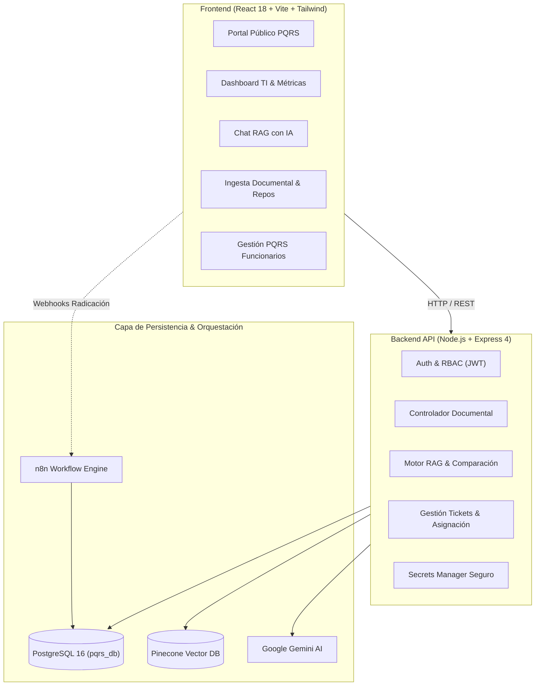

# DocuMind & PQRS B2B Enterprise — Plataforma Unificada de Gestión Documental y Mesa de Ayuda con IA (RAG)

Sistema empresarial integral que combina la **Gestión Documental Inteligente (DocuMind)** con la **Mesa de Ayuda y Automatización de PQRS B2B**, potenciado por modelos de lenguaje de última generación (**Google Gemini**), base de datos vectorial (**Pinecone**) y orquestación de flujos de trabajo (**n8n**).

## Tercer corte: semana 1

Entrega de diseño: [PDF de dos páginas](docs/SEMANA_1_DISENO.pdf) y [fuente editable](docs/SEMANA_1_DISENO.md). Incluye inventario de los cinco flujos, elección de Ruta A, caso de visión y arquitectura propuesta. Diagnóstico del código y pendientes: [STATUS_AUDIT.md](STATUS_AUDIT.md).

Archivos vigentes: `index.html` es el portal autónomo PQRS de los cortes anteriores; `frontend/index.html` inicia la plataforma React; `workflow/n8n_workflow.json` es la exportación importable en n8n. Los dos archivos de `database/` son complementarios. Para regenerar el workflow: `node workflow/build_pqrs_workflow.js`.

La entrega de semana 1 es documental. La migración, OCR y despliegue descritos son trabajo futuro; las afirmaciones históricas del resto del README deben leerse junto con la auditoría, que distingue implementación de funcionamiento comprobado. No se ha verificado una conexión real con PostgreSQL, n8n, SMTP o proveedores de IA en esta revisión.

---

## 🏛️ 1. Visión General de la Plataforma

Este repositorio consolida en un único ecosistema empresarial dos módulos críticos de negocio:

1. **DocuMind (Gestión Documental & RAG Inteligente):**
   - Ingesta y clasificación automática de documentos empresariales (PDF, DOCX, TXT) con extracción inteligente de metadatos (categoría, resumen, entidad, fechas).
   - Base de conocimiento vectorial con **Pinecone** y generación aumentada por recuperación (**RAG**) con **Google Gemini**, permitiendo comparaciones exhaustivas entre repositorios y citas directas de fuentes.
   - Seguridad y aislamiento departamental por repositorios (Legal, Financiero, RRHH, etc.) mediante **Control de Acceso Basado en Roles (RBAC)** y tokens JWT.

2. **PQRS B2B & Mesa de Ayuda Automatizada:**
   - Portal web público de radicación ciudadana y seguimiento seguro mediante código de radicado único (`PQRS-YYYY-NNNNNN`) y token criptográfico UUIDv4.
   - Motor de flujos en **n8n** para clasificación, cálculo dinámico de SLAs (2h a 48h según severidad), alertas por correo SMTP al solicitante y supervisores.
   - Asignación inteligente a agentes operativos, registro de notas internas/públicas, control de versiones optimista y encuestas de satisfacción del cliente (**CSAT**).
   - **Asistente de Solución RAG con IA:** Integración directa que permite a los agentes operativos generar diagnósticos, planes de acción y propuestas de respuesta al cliente a partir del acervo documental de la organización.

---

## 🔒 2. Seguridad, Gestión de APIs y Secretos

> [!IMPORTANT]
> **Gestión Estricta de Credenciales y APIs:**
> Este repositorio **no almacena claves de API ni contraseñas reales**. Toda configuración sensible se gestiona exclusivamente a través de variables de entorno locales (`.env`) o montajes de Docker Secrets (`*_FILE`), las cuales están completamente excluidas del control de versiones mediante `.gitignore`.

### Variables de Entorno Requeridas (`backend/.env`):
```env
PORT=5000
DB_HOST=localhost
DB_PORT=5432
DB_USER=pqrs_user
DB_PASSWORD=tu_contraseña_postgres
DB_NAME=pqrs_db
JWT_SECRET=tu_secreto_seguro_jwt_2026
PINECONE_API_KEY=tu_clave_pinecone
PINECONE_INDEX=documind
GEMINI_API_KEY=tu_clave_google_gemini
N8N_WEBHOOK_URL=http://localhost:5678/webhook/radicar-pqrs
TRUST_PROXY=false
```

### Variables de Entorno Frontend (`frontend/.env`):
```env
VITE_API_BASE_URL=http://localhost:5000/api
```

---

## 🏗️ 3. Arquitectura del Sistema



---

## 🚀 4. Puesta en Marcha Rápida (Windows)

La plataforma incluye scripts automatizados de ciclo de vida para Windows en la raíz del proyecto:

### Iniciar todos los servicios:
Haga doble clic o ejecute desde PowerShell:
```cmd
.\iniciar_documind_pqrs.bat
```
El script realiza automáticamente:
1. Verificación e inicio de **Docker Desktop**.
2. Levantamiento de contenedores de persistencia (**PostgreSQL 16** y **n8n** en red puente).
3. Inicialización del servidor API **Node.js** (`http://localhost:5000`).
4. Inicialización del servidor de desarrollo **Vite** (`http://localhost:5173`).
5. Apertura del navegador en la plataforma.

### Detener todos los servicios limpiamente:
```cmd
.\detener_documind_pqrs.bat
```
Detiene de manera ordenada los servidores Node/Vite y apaga los contenedores Docker liberando memoria RAM y puertos de red.

---

## 🧪 5. Batería de Pruebas y Aseguramiento de Calidad (QA)

El proyecto cuenta con una cobertura integral de pruebas automatizadas:

```bash
# Pruebas unitarias y de integración de backend:
cd backend
npm test

# Compilación y verificación de empaquetado de frontend:
cd ../frontend
npm run build
```

Adicionalmente, se incluye el script de integración de PQRS con el motor n8n:
```cmd
.\ejecutar_pruebas.bat
```

---

## 📚 6. Documentación y Entregables Académicos

Toda la documentación ejecutiva y técnica de sustentación se encuentra organizada en el directorio [`docs/`](file:///docs):

| Documento | Descripción |
| --- | --- |
| [`INFORME_FINAL_ENTREGA_DOCUMIND.md`](file:///docs/INFORME_FINAL_ENTREGA_DOCUMIND.md) | Informe técnico final con arquitectura, casos de uso, matriz de seguridad y métricas. |
| [`RESUMEN_EJECUTIVO_DOCUMIND.md`](file:///docs/RESUMEN_EJECUTIVO_DOCUMIND.md) | Síntesis ejecutiva de alto impacto para evaluadores y jurados. |
| [`PRESENTACION_DOCUMIND.md`](file:///docs/PRESENTACION_DOCUMIND.md) | Estructura diapositiva por diapositiva para la defensa y sustentación oral. |
| [`GUION_DEMO_DOCUMIND.md`](file:///docs/GUION_DEMO_DOCUMIND.md) | Guión paso a paso para la demostración en vivo de la plataforma. |
| [`PREGUNTAS_DEFENSA_DOCUMIND.md`](file:///docs/PREGUNTAS_DEFENSA_DOCUMIND.md) | Banco de preguntas técnicas difíciles y respuestas sustentadas sobre arquitectura, RAG y seguridad. |
| [`MATRIZ_ACEPTACION_DOCUMIND.md`](file:///docs/MATRIZ_ACEPTACION_DOCUMIND.md) | Matriz de pruebas de aceptación UAT y criterios de calidad. |
| [`DRP_PLAN_RECUPERACION.md`](file:///docs/DRP_PLAN_RECUPERACION.md) | Plan de contingencia, continuidad del negocio y recuperación ante desastres (DRP/HA). |
| [`PANEL_SUSTENTACION.html`](file:///docs/PANEL_SUSTENTACION.html) | Panel interactivo de apoyo visual para la exposición en clase. |

---

## 👥 7. Autores y Créditos

- **Desarrollador Líder:** Juan Felipe ([@JuanFe28](https://github.com/JuanFe28))
- **Plataforma:** DocuMind & PQRS B2B
- **Tecnologías:** Node.js, Express, React, Vite, Tailwind CSS, PostgreSQL 16, n8n, Google Gemini AI, Pinecone.
