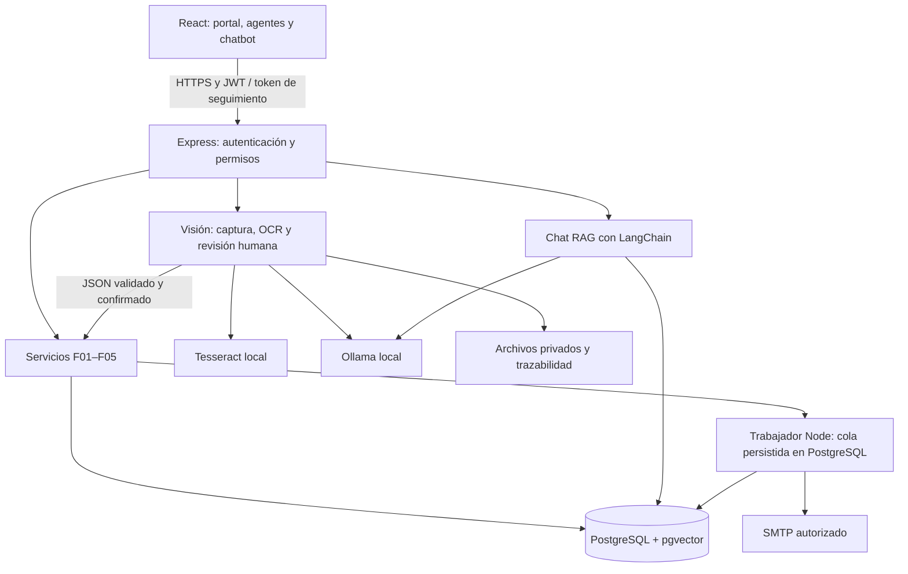

# Semana 1 — Diseño de automatización y visión

**Proyecto:** DocuMind & PQRS B2B · **Asignatura:** Desarrollo de Aplicaciones Empresariales · **Fecha:** 28/10/2026.
**Base:** `camachoab21-cmd/documind-pqrs-b2b`, revisión `58db32a`. Documento de diseño propuesto para el tercer corte; no acredita implementación ni despliegue de las capacidades futuras. La versión PDF contiene dos páginas.

## 1. Problema, objetivo y alcance

La plataforma combina radicación y seguimiento PQRS, gestión de agentes y documentos, y chatbot RAG. Conserva un portal HTML y una aplicación React/Express. La automatización PQRS reside en n8n y funciones de PostgreSQL; el chatbot y el análisis documental ya están programados en Express. El objetivo es conservar esas funciones, retirar la dependencia operativa de n8n y digitalizar formularios físicos PQRS. Esta semana entrega únicamente inventario, decisiones y arquitectura; no incorpora funcionalidades al aplicativo.

## 2. Inventario verificable de automatizaciones

Fuente: `workflow/n8n_workflow.json`. Un workflow, cinco entradas HTTP, 44 nodos, ocho nodos PostgreSQL y dos SMTP. No contiene nodos de IA ni disparadores programados. La clasificación usa reglas; las alertas son inmediatas por urgencia, no un monitor periódico de vencimientos.

| ID / disparador | Pasos y servicios externos | Resultado / destino Ruta A |
|---|---|---|
| F01 · POST `radicar-pqrs` | Validar y normalizar; clasificar área; `pqrs_radicar` en PostgreSQL; SMTP de confirmación y, si urgente, escalamiento; guardar resultado de correo. | Radicado, token privado y SLA; servicio de radicación y trabajador de correo. |
| F02 · GET `consultar-pqrs` (Basic Auth) | `pqrs_listar` en PostgreSQL; calcular/proyectar KPIs, últimos 100 tickets y agentes. | Listado operativo; servicio de consulta con JWT y roles. |
| F03 · GET `consultar-ticket` | Validar radicado y token; `pqrs_tracking` en PostgreSQL; excluir notas internas. | Seguimiento privado; adaptar el endpoint Express existente a la misma semántica. |
| F04 · POST `actualizar-ticket` (Basic Auth) | Validar agente, estado, nota, versión y operación; `pqrs_actualizar` en PostgreSQL. | Cambio e historial atómicos; servicio con idempotencia y conflicto 409. |
| F05 · POST `calificar-ticket` | Validar token y puntuación; `pqrs_calificar` en PostgreSQL; exigir ticket resuelto/cerrado. | CSAT 1–5 y actividad; servicio de satisfacción. |

## 3. Ruta elegida y continuidad del chatbot

**Ruta A: servicios propios Node.js/Express**, reutilizando las funciones PostgreSQL y los contratos del inventario. Es la elección técnica de esta propuesta: aprovecha el backend y evita mantener dos motores. La Ruta B conservaría n8n en Docker, pero añade operación y exige migrar un flujo con IA; el workflow examinado no contiene IA. Se preservarán SLA de 2/4/24/48 horas corridas, `request_id`, `operation_id`, versión y resultados SMTP.

El chatbot conservará hilos, permisos por repositorio, fuentes y consulta documental. Se propone LangChain JavaScript con Ollama local para generación y embeddings; la variante concreta del modelo se fijará según memoria y latencia del servidor disponible. Se almacenarán fragmentos y vectores en PostgreSQL con pgvector y se reindexará con un único modelo. Pinecone y Gemini son dependencias actuales, no requisitos de la arquitectura objetivo. No se mezclarán embeddings de distintos modelos ni se presentarán heurísticas como respuestas de IA verificadas.

## 4. Caso de visión elegido: lectura de formularios físicos PQRS

Un agente autenticado carga una foto de celular (JPG/PNG) o un PDF escaneado de un formulario impreso. OCR local Tesseract extrae texto; Ollama mediante LangChain lo estructura como JSON: `nombre`, `email`, `telefono`, `tipo_solicitud`, `asunto`, `descripcion`, confianza por campo y advertencias. El agente revisa y confirma; con confianza inferior a 0,85 o campos obligatorios inválidos se exige corrección. El umbral es inicial y se calibrará; no equivale a un porcentaje de aciertos. La escritura manuscrita queda fuera del alcance inicial.

Tras confirmación se ejecuta F01 con un `request_id` persistente, se vincula la imagen al ticket y se muestran radicado y SLA. Prioridad y departamento se validan con las reglas de negocio; el modelo no decide el cierre. El chatbot ofrecerá el mismo proceso de revisión y confirmación, reutilizando el servicio de visión. Si OCR/IA falla, queda pendiente para corrección o reintento y se permite radicación manual.

## 5. Arquitectura propuesta

React, Express y PostgreSQL se conservan; servicios unificados, visión, LangChain/Ollama, pgvector y trabajador son componentes propuestos. n8n queda como especificación histórica después de verificar paridad. La infraestructura objetivo es un servidor institucional o propio disponible sin costo adicional, con HTTPS; su acceso y capacidad deben confirmarse antes del despliegue. No se supone que un alojamiento gratuito pueda ejecutar cualquier modelo local.

## 6. Calidad, validación y próximos hitos

Se propone una cola persistente para correo y tareas IA, con tres intentos ante fallos transitorios, espera creciente e idempotencia; registrar fecha, flujo, actor, entrada redactada, resultado y error. Aplicar permisos en servidor, archivos privados y registro de quién cargó cada imagen y cuándo. Nombres, correo y teléfono permanecen en procesamiento local; definir finalidad, autorización y retención antes de usar datos reales. Los secretos seguirán en variables de entorno.

Semana 2: al menos tres de los cinco flujos y chatbot en el motor nuevo. Semana 3: captura y OCR. Semana 4: integración, seguridad, despliegue y evaluación con 20 fotos reales de celular, variando luz, inclinación y calidad; comparar cada campo contra transcripción revisada y reportar `aciertos / campos evaluados × 100`, fallos y correcciones. Semana 5: documentación y sustentación. Se probarán además duplicados, conflictos 409, token incorrecto, caída de correo/modelo y recuperación. No hay resultados de OCR ni porcentajes medidos todavía.

**Insumos de las siguientes semanas:** servidor con capacidad para el modelo, acceso SMTP de prueba y 20 formularios fotografiados con datos ficticios o autorización. No son necesarios para completar este diseño.

**Fuentes:** guía de Wilson Castaño Galviz, 26/10/2026, pp. 2–4 (inventario, rutas, OCR y semana 1); código de la revisión indicada; [Tesseract](https://tesseract-ocr.github.io/tessdoc/) y [LangChain / ChatOllama](https://docs.langchain.com/oss/javascript/integrations/chat/ollama), consultados el 28/10/2026. Hallazgos y evidencia ampliada: [STATUS_AUDIT.md](../STATUS_AUDIT.md).
