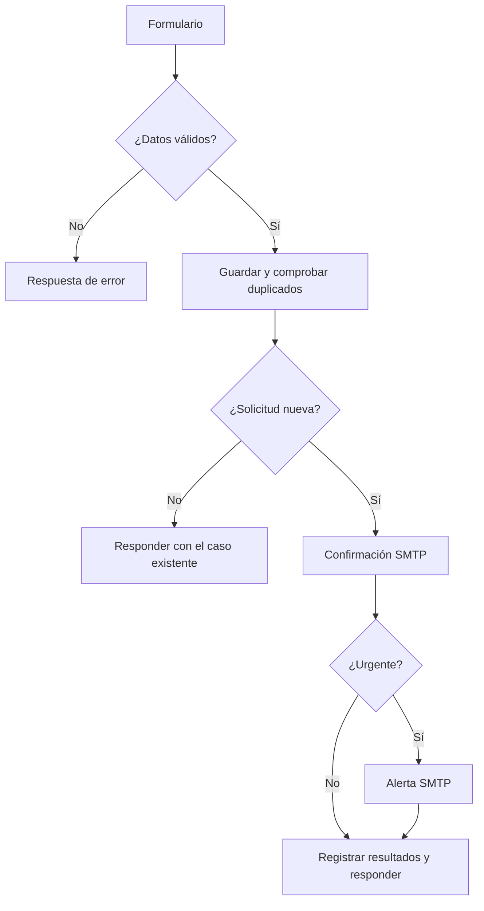

# Especificación del proyecto PQRS y soporte

Esta especificación describe los archivos incluidos en esta entrega. Se conserva su nombre original para mantener la estructura del ZIP. La fuente de los requisitos académicos es `Actividad_Automatizacion_Proceso_Empresarial.pdf`; las decisiones técnicas del equipo se detallan aquí y en el README.

## 1. Objetivo y alcance

Automatizar la recepción de solicitudes que, en el escenario propuesto, se registran y distribuyen manualmente. El sistema recibe la información, la valida y clasifica, determina una ruta de atención, guarda el caso y ejecuta notificaciones. El solicitante puede consultar su caso y el agente puede asignarlo, cambiar su estado y registrar notas.

El proyecto conserva el formulario, el panel, las tres tablas principales y los cuatro endpoints del compañero. Las correcciones completan esas funciones. No se implementan una plataforma SaaS multiempresa, inteligencia artificial, Kanban, vigilancia programada de vencimientos ni integraciones con Slack, Telegram o WhatsApp. La configuración no acredita cumplimiento normativo ni pruebas exitosas en una instalación que todavía no se ha conectado.

## 2. Componentes y recorrido

| Componente | Responsabilidad |
| --- | --- |
| HTML, CSS y JavaScript | Formulario, comprobante, seguimiento, panel y exportación CSV. |
| n8n 2.4.8 | Webhooks, validación, clasificación, condiciones, coordinación de consultas y SMTP. |
| PostgreSQL | Solicitudes, agentes, historial, controles de duplicados y resultados de notificación. |
| SMTP | Confirmación al solicitante y alerta al responsable cuando el caso es urgente. |

La persistencia precede al correo. El error de un envío no elimina la solicitud. Cada intento lógico usa un `request_id` UUIDv4 que el formulario conserva en los reintentos; una restricción única y el bloqueo transaccional impiden crear dos casos para ese identificador. Un reintento con contenido diferente devuelve conflicto.

Un error de configuración conserva el identificador porque puede existir un intento anterior guardado cuya respuesta se perdió. El comprobante confirmado vuelve a mostrarse al regresar al servidor original, incluso si la respuesta llega después de haber cambiado de servidor.

Los mensajes no se reenvían automáticamente. `ENVIADA` significa aceptación del destinatario por el servidor SMTP; la recepción en su buzón se comprueba aparte. `ERROR` indica rechazo explícito y `SIN_CONFIRMAR` indica que no se conoce la aceptación. `ENVIANDO` puede quedar pendiente si una ejecución se interrumpe. Antes de un reenvío manual debe revisarse la ejecución y el proveedor.

## 3. Datos y reglas

Campos de entrada: nombre, correo, teléfono opcional, área opcional, tipo, prioridad, asunto y descripción, además del identificador del envío. La validación controla tipos, longitudes y opciones admitidas; normaliza espacios, correo, mayúsculas y tildes de las opciones.

Si el área se deja en selección automática, se aplica esta precedencia: soporte técnico se dirige a Soporte Técnico y Sistemas; textos que incluyen facturación o cobro se dirigen a Facturación y Cobranzas; quejas y reclamos a Control de Calidad y Garantías; los demás casos a Atención al Cliente General. Un área válida elegida explícitamente se conserva.

| Regla, en orden | Plazo | Ruta |
| --- | --- | --- |
| Prioridad crítica | 2 horas corridas | Urgente |
| Prioridad alta o tipo reclamo | 4 horas corridas | Urgente |
| Prioridad baja sin regla anterior | 48 horas corridas | Estándar |
| Demás casos válidos | 24 horas corridas | Estándar |

Estos plazos son una política del proyecto y se calculan desde la radicación. No son horas hábiles ni plazos legales.

Tablas: `pqrs_solicitudes`, `pqrs_actividades` y `usuarios_agentes`. El SQL mantiene los campos equivalentes existentes para compatibilidad y añade identificadores de reintento, clave privada de seguimiento, versión y estados de correo. El estado, agente, fecha y actividad se actualizan en una misma transacción. Se valida que el agente exista y esté activo.

Estados: NUEVO, ASIGNADO, EN_GESTION, ESPERANDO_CLIENTE, RESUELTO y CERRADO. Resolver o cerrar establece la fecha de resolución; reabrir la limpia. Una versión antigua no puede sobrescribir una gestión más reciente. Cada operación de actualización tiene un identificador estable para que el reintento no repita la nota.

El panel permite reintentar la operación pendiente con sus datos originales aunque el caso ya no esté entre los últimos 100 del listado. Requiere autenticarse en el mismo servidor de esa operación.

## 4. Endpoints y acceso

| Método | Ruta bajo `/webhook` | Uso y acceso |
| --- | --- | --- |
| POST | `/radicar-pqrs` | Crear solicitud; validación del cuerpo JSON. |
| GET | `/consultar-pqrs` | Listado, métricas y agentes; requiere Basic Auth. |
| GET | `/consultar-ticket?id=...&token=...` | Seguimiento con radicado y clave privada; excluye notas internas. |
| POST | `/actualizar-ticket` | Asignar agente, cambiar estado y registrar nota; requiere Basic Auth. |

Basic Auth protege las dos operaciones administrativas con una credencial compartida configurada en n8n. El selector de agente identifica a quién se asigna la gestión y no sustituye cuentas individuales. El frontend mantiene esa credencial únicamente en memoria. La demostración se prepara en el mismo computador; el acceso remoto requiere HTTPS.

El contrato completo de campos, respuestas HTTP y configuración está en el README. El formulario muestra confirmaciones únicamente después de una respuesta válida del servidor. No crea casos simulados cuando falla la conexión. Los ejemplos visibles solo rellenan campos y están identificados como ficticios.

## 5. Indicadores e historial

Las métricas se calculan sobre todos los registros; tabla y CSV incluyen los últimos 100 casos. El porcentaje de cumplimiento incluye casos abiertos dentro del plazo y casos terminados con fecha de resolución anterior o igual al vencimiento. Un caso resuelto tarde no cuenta como cumplido. Sin casos se muestra `--`; cero por ciento se muestra `0%`.

El panel ve el historial interno y público. El seguimiento del cliente solo recibe actividades públicas y no permite consultar el listado general. La exportación CSV escapa comillas, saltos de línea y celdas que podrían interpretarse como fórmulas.

## 6. Instalación y pruebas

Siga el README para preparar PostgreSQL en Docker, ejecutar el SQL, importar el JSON, seleccionar credenciales Postgres/SMTP/Basic Auth y configurar remitente y responsable. No se modifica directamente la base SQLite interna de n8n.

`tests/probar_solicitudes.js` contiene aserciones HTTP para creación, persistencia, duplicados, errores, seguimiento, notas internas, resolución, reapertura y estados SMTP. Requiere los servicios configurados y buzones autorizados. No se presenta su ejecución pendiente como una prueba aprobada. El README distingue las verificaciones locales de las pruebas por ejecutar en el equipo del usuario.

## 7. Prompt de mantenimiento del proyecto

Trabaja sobre esta misma estructura y sus cuatro endpoints. Conserva la interfaz y corrige únicamente comportamientos vinculados a recepción, validación, clasificación, prioridad, persistencia, notificación y seguimiento. Basa los requisitos académicos en el PDF y marca las decisiones técnicas como decisiones del equipo. No añadas productos, canales, funciones comerciales ni afirmaciones normativas. No inventes credenciales ni resultados de pruebas. Comprueba las correcciones con entradas y salidas observables y actualiza esta especificación y el README cuando cambie el contrato.
